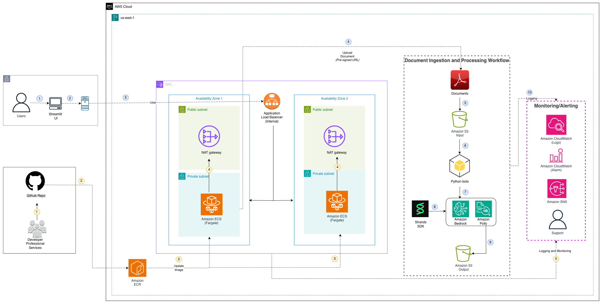
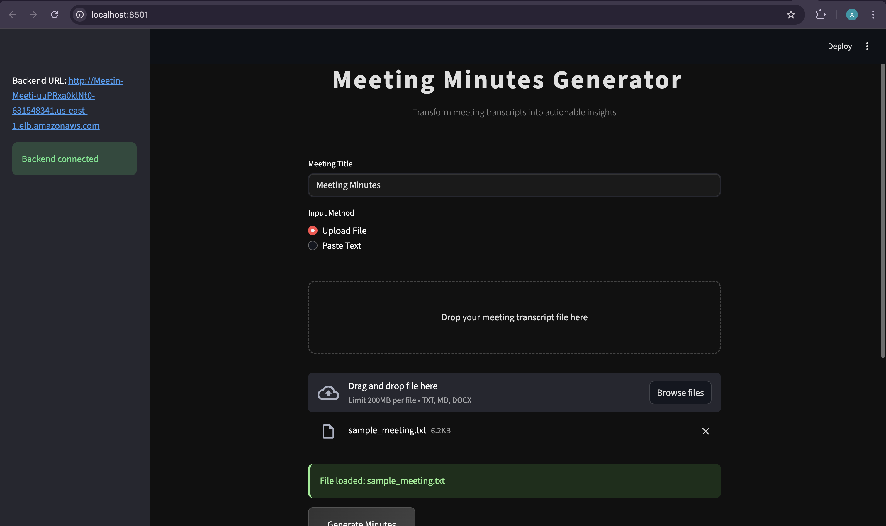
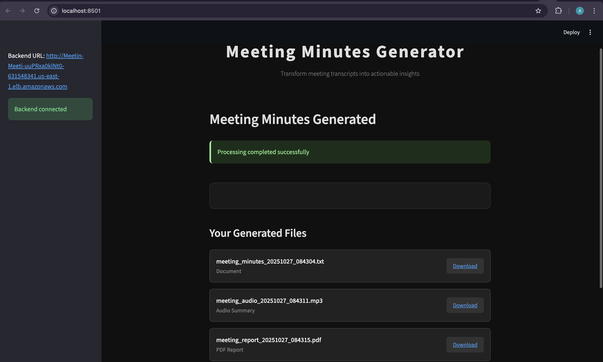

# AI Meeting Minutes Generator

A production-ready AI-powered meeting transcript processing system using Strands SDK multi-agent architecture, deployed on AWS Fargate.

## Overview

This system transforms raw meeting transcripts into comprehensive professional documentation packages using AI multi-agent processing. It leverages the Strands SDK to coordinate specialized AI agents that each handle specific aspects of meeting documentation.

### What It Generates

1. **Structured Meeting Minutes** - Professional plain text formatted minutes with sections for attendees, discussion points, decisions, and action items
2. **Concise Summary** - Executive summary under 3000 characters for audio generation
3. **Audio Summary** - MP3 audio file generated from concise summary using AWS Polly
4. **Comprehensive PDF Report** - Professional PDF document with meeting content and metadata

### Problems Solved

1. **Manual Documentation Overhead** - Eliminates hours of manual meeting minute creation
2. **Inconsistent Documentation Quality** - Ensures standardized, professional output format
3. **Missing Action Items** - AI systematically identifies and extracts actionable items
4. **Poor Meeting Analysis** - Provides quantitative insights into meeting effectiveness
5. **Accessibility** - Generates multiple formats (text, audio, visual) for different consumption preferences

## Architecture

### System Architecture Diagram



### Component Breakdown

1. **API Layer (FastAPI)** - Handles HTTP requests, file uploads, job management
2. **Processing Layer (Strands SDK)** - Multi-agent orchestration and AI processing
3. **Storage Layer (S3)** - File storage only (job status is in-memory)
4. **Frontend Layer (Streamlit)** - User interface for interaction and file management
5. **Infrastructure Layer (AWS Fargate)** - Containerized deployment with auto-scaling

## Strands SDK Implementation

### Multi-Agent Architecture Pattern

The system implements a **4-Agent Sequential Processing** pattern using Strands SDK tools, where agents are wrapped as callable functions using the `@tool` decorator. There is NO orchestrator agent - processing is sequential and direct.

## Data Flow

### Complete Data Processing Pipeline

The system processes meeting transcripts through a sophisticated multi-stage pipeline:

#### 1. Input Stage
```
User Input → File Upload/Text → FastAPI Endpoint → Job Creation
```

**Entry Points:**
- `/upload-direct` - Direct file upload with immediate processing
- `/process-s3-meeting` - Process content from S3 or direct text
- `/upload-url` - Generate presigned URL for frontend S3 upload

**Input Validation:**
- File size limits (no explicit limit in code, ALB has 16MB limit)
- Content encoding detection (UTF-8, Latin-1, CP1252 fallback)
- Empty content validation (checks for stripped content)
- File type validation (.txt, .md, .docx via Streamlit file_uploader)

#### 2. Job Management & Persistence
```
Job Creation → UUID Generation → In-Memory Storage → Background Processing
```

**Job Status Lifecycle:**
```python
# Job Status States (Enum)
PROCESSING → COMPLETED | FAILED

# In-Memory Job Storage
jobs = {}  # Dictionary storing job status

# Job Structure:
{
    "job_id": str,
    "status": JobStatus,
    "meeting_title": str,
    "created_at": str,
    "completed_at": str,
    "processing_time_seconds": int,
    "output_files": List[OutputFile]
}
```

#### 3. AI Processing Pipeline
```
Content → Strands SDK → Sequential Agent Processing → File Generation
```

**Sequential Agent Workflow (4-Agent System):**
1. **Minutes Generator Agent** (`generate_structured_minutes`) - Creates structured meeting minutes in plain text
2. **Concise Minutes Agent** (`concise_minutes_agent`) - Generates executive summary under 3000 characters
3. **Audio Generator Agent** (`audio_generator_agent`) - Converts concise summary to MP3 using Strands speak tool
4. **PDF Generator Agent** (`create_comprehensive_pdf`) - Creates PDF report using ReportLab (also an agent with @tool decorator)

**Agent Implementation Pattern:**
```python
@tool
def agent_function(content: str) -> str:
    agent = Agent(system_prompt="...", tools=[...])
    return agent(content)
```

#### 4. File Processing & Storage
```
Agent Output → Local File Creation → S3 Upload → Presigned URL Generation
```

**File Generation Process:**
- **Minutes**: Plain text (.txt) format with structured sections and timestamps
- **Audio**: MP3 files generated via AWS Polly through Strands speak tool
- **PDF**: ReportLab-generated comprehensive reports with custom styling
- **Fallback Files**: Text files created when PDF/audio generation fails

**S3 Upload Validation:**
```python
# Critical validation to prevent NoneType errors
if content is not None and len(content) > 0:
    s3_client.put_object(Bucket=bucket, Key=key, Body=content)
    # Verify upload with head_object
```

#### 5. Download & Retrieval
```
Completed Job → Presigned URLs → Client Download → Local Cleanup
```

**Download Mechanisms:**
- **S3 Downloads**: `/download/{s3_key:path}` with streaming response from S3
- **Local Downloads**: `/download-local/{filename}` for development mode
- **Presigned URLs**: Generated for frontend with 24-hour expiry (86400 seconds)

### Data Flow Error Handling

#### Resilience Patterns
1. **Graceful Degradation**: Fallback text files when PDF/audio generation fails
2. **Content Validation**: Multiple encoding attempts and content verification
3. **In-Memory Storage**: Job status does NOT survive container restarts (stored in memory only)
4. **Timeout Management**: 15-minute ALB timeout (900 seconds) for long AI processing

#### Error Recovery
```python
# Fallback file creation pattern
try:
    primary_generation()
except Exception:
    create_fallback_file(error_info)
```

### Performance Characteristics

#### Processing Times
- **Simple Meeting** (<1000 words): 2-3 minutes
- **Medium Meeting** (1000-5000 words): 3-5 minutes
- **Complex Meeting** (>5000 words): 5-10 minutes

#### Resource Usage
- **Memory**: 1-1.5GB during processing (2048 MiB container limit)
- **CPU**: 60-80% during AI processing (1024 CPU units)
- **Storage**: 50-200MB per job (auto-cleanup after 10 minutes via cleanup_old_files - 600 seconds for files older than 10 minutes)

#### Scaling Behavior
```
Auto-scaling Triggers:
- CPU > 70% → Scale out (max 3 instances)
- Memory > 70% → Scale out
- Cool-down: 5min scale-out, 10min scale-in
```

### Security & Access Control

#### AWS IAM Permissions
```json
{
  "bedrock:InvokeModel": "*",
  "polly:SynthesizeSpeech": "*", 
  "s3:GetObject|PutObject|DeleteObject": "input/output buckets",
  "logs:CreateLogStream|PutLogEvents": "log groups"
}
```

#### Data Lifecycle
- **Job Status**: In-memory storage (lost on container restart)
- **Output Files**: S3 storage with 90-day retention, 30-day noncurrent version expiration
- **Local Files**: 10-minute cleanup cycle (cleanup_old_files function removes files older than 600 seconds)
- **Presigned URLs**: 24-hour expiry (86400 seconds) when S3 is configured

## Security Architecture

### Network Security
- **Private Subnet Isolation**: Containers run in private subnets with no direct internet access
- **ALB Security Gateway**: All traffic filtered through Application Load Balancer in public subnets
- **Container Binding**: `0.0.0.0:8000` binding required because ALB uses dynamic IP addresses that change across availability zones, during scaling events, and maintenance windows - containers cannot predict these IPs in advance
  ```dockerfile
  # Dockerfile CMD - binds to all interfaces for ALB connectivity
  CMD ["uvicorn", "app:app", "--host", "0.0.0.0", "--port", "8000"]
  ```
- **Security Groups**: Only ALB can reach container port 8000 (principle of least privilege)

### API Security
- **Stateless Public API**: No authentication required, processes meeting transcripts only
- **CORS Configuration**: `allow_origins=["*"]` with `allow_credentials=False`
  - Safe because: No authentication, no cookies/sessions, no sensitive data
  - Necessary for: Development (different ports), production integrations, testing flexibility
- **Frontend Model**: Streamlit UI for local development/testing only - not deployed to production

### Data Protection
- **S3 Encryption**: Server-side encryption enabled on all buckets
- **S3 Versioning**: Enabled for data protection and recovery
- **SNS Encryption**: SSL/TLS enforcement (`enforceSSL: true`) for all SNS communications
- **Transit Encryption**: HTTPS/TLS for all communications
- **Data Lifecycle**: 90-day S3 retention, 10-minute local cleanup, 24-hour presigned URLs

### Container Security
- **Non-root Execution**: Application runs as `appuser`
- **Minimal Base Image**: `python:3.12-slim` for reduced attack surface with pinned system packages for security compliance
  ```dockerfile
  # Dockerfile - pinned versions prevent security vulnerabilities
  RUN apt-get install -y git=1:2.47.3-0+deb13u1 curl=8.14.1-2
  ```
- **Resource Limits**: CPU/memory limits prevent resource exhaustion
- **Health Monitoring**: Container health checks and CloudWatch logging

### Infrastructure Security
- **VPC Design**: Private subnets for containers, public subnets for ALB only
- **IAM Permissions**: Minimal required permissions (Bedrock, Polly, S3, CloudWatch)
- **Monitoring**: CloudWatch logs, SNS alerts, Container Insights
- **Automated Updates**: Security patching through container rebuilds

## Installation & Deployment

### Prerequisites

```bash
# Ensure Docker Desktop is running locally
# Verify Docker is running
docker --version

# AWS CLI configured with appropriate permissions
aws configure

# Node.js and npm installed for CDK
node --version
npm --version
```

### Step 1: Clone and Setup

```bash
# Clone repository
git clone <repository-url>
cd meeting_minutes_agent

# Create virtual environment
python -m venv .venv
source .venv/bin/activate  # Linux/Mac
# or
.venv\Scripts\activate     # Windows

# Install dependencies
pip install -r app/requirements.txt
```

### Step 2: AWS Authentication

```bash
# Login to AWS ECR Public (required for Docker base images)
aws ecr-public get-login-password --region us-east-1 | docker login --username AWS --password-stdin public.ecr.aws

# Verify ECR login successful
docker pull public.ecr.aws/docker/library/python:3.12-slim
```

### Step 3: Configure AWS CDK

```bash
# Navigate to infrastructure
cd infrastructure

# Install CDK dependencies
npm install

# Bootstrap CDK (first time only per AWS account/region)
cdk bootstrap

# Verify CDK setup
cdk ls
```

### Step 4: Deploy Infrastructure

```bash
# Deploy to AWS
cdk deploy

# Note the outputs:
# - LoadBalancerDNS: your-alb-dns.region.elb.amazonaws.com
# - InputBucketName: meeting-minutes-inputs-{account}-{region}
# - OutputBucketName: meeting-minutes-outputs-{account}-{region}
```

### Step 5: Test Deployment

```bash
# Test health endpoint
curl http://your-alb-dns.region.elb.amazonaws.com/health

# Expected response:
{
    "status": "healthy",
    "timestamp": "2024-01-15T10:30:00Z",
    "s3_configured": true
}
```

### Step 6: Run Frontend (Local Testing)

```bash
# Open new terminal and activate virtual environment
source .venv/bin/activate  # Linux/Mac
# or
.venv\Scripts\activate     # Windows

# Install Streamlit for local testing
pip install streamlit

# Run frontend with backend URL
BACKEND_URL="http://your-alb-dns.region.elb.amazonaws.com" streamlit run app/streamlit_app.py
```

## API Documentation

### Base URL
```
http://your-alb-dns.region.elb.amazonaws.com
```

### Endpoints

#### 1. Health Check
```bash
GET /health

Response:
{
    "status": "healthy",
    "timestamp": "2024-01-15T10:30:00Z",
    "s3_configured": true
}
```

#### 2. Process Meeting Content

**File Upload:**
```bash
curl -X POST \
  -F "file=@meeting_transcript.txt" \
  -F "meeting_title=Weekly Team Meeting" \
  http://your-alb-dns/upload-direct
```

**Text Content:**
```bash
curl -X POST \
  -H "Content-Type: application/json" \
  -d '{"content":"Meeting started at 9 AM...","meeting_title":"Weekly Team Meeting"}' \
  http://your-alb-dns/process-s3-meeting
```

**Response:**
```json
{
    "job_id": "550e8400-e29b-41d4-a716-446655440000",
    "status": "processing",
    "message": "Meeting processing started",
    "meeting_title": "Weekly Team Meeting"
}
```

#### 3. Check Job Status
```bash
curl http://your-alb-dns/job-status/550e8400-e29b-41d4-a716-446655440000

Response (Processing):
{
    "job_id": "550e8400-e29b-41d4-a716-446655440000",
    "status": "processing",
    "meeting_title": "Weekly Team Meeting",
    "created_at": "2024-01-15T10:30:00Z"
}

Response (Completed):
{
    "job_id": "550e8400-e29b-41d4-a716-446655440000", 
    "status": "completed",
    "meeting_title": "Weekly Team Meeting",
    "created_at": "2024-01-15T10:30:00Z",
    "completed_at": "2024-01-15T10:35:00Z",
    "processing_time_seconds": 300,
    "output_files": [
        {
            "filename": "meeting_minutes_20240115_103500.txt",
            "download_url": "http://your-alb-dns/download-local/meeting_minutes_20240115_103500.txt"
        },
        {
            "filename": "meeting_report_20240115_103500.pdf",
            "download_url": "http://your-alb-dns/download-local/meeting_report_20240115_103500.pdf"
        }
    ]
}
```

#### 4. Download Files
```bash
curl -O http://your-alb-dns/download/550e8400-e29b-41d4-a716-446655440000/meeting_report_20240115_103500.pdf
```

#### 5. List Recent Jobs
```bash
curl http://your-alb-dns/jobs

Response:
{
    "jobs": ["550e8400-e29b-41d4-a716-446655440000"],
    "total": 1
}
```

## Frontend Usage

### Streamlit Interface



### Interface Features

1. **File Upload Area**
   - Drag-and-drop support
   - Accepts .txt, .md, .docx files
   - Alternative text input area

2. **Processing Status**
   - Real-time progress updates
   - Step-by-step workflow visualization
   - Auto-refresh until completion

3. **Results Dashboard**
   - Download buttons for each output type
   - File preview options
   - Job history tracking

### Output Results



### Frontend Workflow

```python
# 1. User uploads meeting transcript or pastes text
# 2. Frontend submits to /process-s3-meeting
# 3. Receives job_id and starts polling /job-status/{job_id}
# 4. Shows progress updates until status = "completed"
# 5. Displays download links for all generated files
```

## Monitoring & Troubleshooting

### CloudWatch Logs

```bash
# View service logs
aws logs tail /ecs/meeting-minutes-service --follow

# Filter for errors
aws logs filter-log-events \
  --log-group-name /ecs/meeting-minutes-service \
  --filter-pattern "ERROR"
```

### Common Issues

#### 1. CDK Bootstrap Issues
```bash
# If CDK bootstrap fails
cdk bootstrap --force

# Check CDK version compatibility
cdk --version
npm list aws-cdk-lib

# Clear CDK cache if needed
rm -rf cdk.out/
```

#### 2. Docker/ECR Authentication Issues
```bash
# Re-authenticate with ECR if Docker build fails
aws ecr-public get-login-password --region us-east-1 | docker login --username AWS --password-stdin public.ecr.aws

# Verify Docker Desktop is running
docker ps

# Clear Docker cache if needed
docker system prune -f
```

#### 3. Streamlit Frontend Issues
```bash
# If Streamlit not found
pip install streamlit

# If backend connection fails
# Check ALB DNS name is correct
curl http://your-alb-dns/health

# Verify virtual environment is activated
which python
```

#### 4. Job Status "Failed"
```bash
# Check job details for error message
curl http://your-alb-dns/job-status/{job_id}

# Common causes:
# - Invalid transcript format
# - Bedrock model access denied  
# - S3 permissions issues
# - Timeout (>15 minutes processing - ALB timeout)
```

#### 5. Health Check Failing
```bash
# Check container logs
aws logs tail /ecs/meeting-minutes-service --follow

# Common causes:
# - S3 bucket access denied
# - Missing environment variables
# - Strands SDK initialization failure
# - ECR authentication expired
```

#### 6. File Download Issues
```bash
# Verify file exists in S3
aws s3 ls s3://meeting-minutes-outputs-{account}-{region}/{job_id}/

# Check S3 permissions
aws s3api head-object \
  --bucket meeting-minutes-outputs-{account}-{region} \
  --key {job_id}/{filename}
```